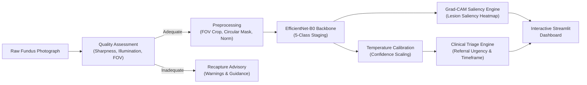

# 👁️ OCULI: Diabetic Retinopathy Screening & Triage Research Prototype

[](https://www.python.org/)
[](https://pytorch.org/)
[](LICENSE)
[](https://streamlit.io/)

> **Research Prototype Notice**: Oculi is a computer vision research prototype developed for academic and engineering experimentation. The initial repository utilizes an **EfficientNet-B0** backbone initialized with ImageNet features and is **NOT** a clinically validated medical device. It should not be used as a primary diagnostic tool without training and formal clinical trials on certified fundus datasets.

---

## 📌 Overview

**Oculi** provides an end-to-end modular pipeline for automated retinal fundus screening, severity grading, interpretability, and clinical referral triage according to the **International Clinical Diabetic Retinopathy Disease Severity Scale**:

| Grade | Clinical Stage | Diagnostic Hallmarks | Referral Protocol |
|:---:|:---|:---|:---|
| **0** | **No DR** | No retinal abnormalities | Routine Annual Rescreening (12 Months) |
| **1** | **Mild NPDR** | Microaneurysms only | Clinical Surveillance (6 - 12 Months) |
| **2** | **Moderate NPDR** | Microaneurysms, hemorrhages, hard exudates | Routine Ophthalmic Referral (2 - 3 Months) |
| **3** | **Severe NPDR** | 4-2-1 rule criteria (extensive hemorrhages, venous beading) | High-Priority Referral (2 - 4 Weeks) |
| **4** | **Proliferative DR** | Neovascularization, vitreous/preretinal hemorrhage | Urgent Referral (Within 1 Week) |

*Grades $\ge 2$ define **Referable Diabetic Retinopathy (RDR)** requiring specialist ophthalmology evaluation.*

---

## 🏗️ System Architecture



---

## 📁 Repository Structure

```text
OCULI/
├── .gitignore               # Excludes datasets, checkpoints, venv, secrets, caches
├── pyproject.toml           # Modern package configuration & pytest setup
├── requirements.txt         # Core dependencies for local and Colab environments
├── README.md                # Project documentation and workflows
├── configs/
│   └── default.yaml         # Dataset, quality, model, training, and triage configs
├── src/
│   └── oculi/
│       ├── __init__.py      # Package exports and version metadata
│       ├── data/
│       │   ├── __init__.py
│       │   └── dataset.py   # Dataset loader, transforms, synthetic fundus generator
│       ├── preprocessing/
│       │   ├── __init__.py
│       │   └── quality.py   # Sharpness (Laplacian), illumination & FOV analysis
│       └── models/
│           ├── __init__.py
│           ├── backbone.py  # EfficientNet-B0 backbone architecture
│           └── predictor.py # DRPredictor, TemperatureScaler, GradCAM, TriageEngine
├── scripts/
│   ├── train.py             # Model training with QWK metric, AMP, and dry-run
│   └── evaluate.py          # Validation audit, confusion matrix & RDR sensitivity/specificity
├── app/
│   └── streamlit_app.py     # Interactive clinician and researcher web interface
└── tests/
    ├── __init__.py
    └── test_quality.py      # Automated unit tests for quality, model & triage logic
```

---

## 🚀 Quickstart: Local Windows Setup

### 1. Create and Activate Virtual Environment
Open PowerShell in the `OCULI` directory:

```powershell
python -m venv .venv
.\.venv\Scripts\Activate.ps1
```

### 2. Install Dependencies
Install in editable development mode:

```powershell
pip install -e .
```

### 3. Run Automated Tests
Execute the unit test suite:

```powershell
pytest -v tests/
```

### 4. Verify Training & Evaluation Pipeline (Dry Run)
Test training loop on local CPU/GPU using simulated synthetic fundus data:

```powershell
python scripts/train.py --dry-run --epochs 1 --batch-size 4
python scripts/evaluate.py --dry-run --synthetic-samples 10
```

### 5. Launch Interactive Streamlit Dashboard
```powershell
streamlit run app/streamlit_app.py
```
Open your browser at `http://localhost:8501` to test fundus quality verification, 5-grade staging, Grad-CAM overlays, and triage recommendations.

---

## ☁️ Google Colab Training Workflow

For training on GPU accelerators using datasets like **APTOS 2019 Blindness Detection** or **EyePACS (Kaggle DR)**:

### 1. Initialize Colab Session
Select a GPU runtime (**Runtime -> Change runtime type -> T4 GPU**).

```python
# Clone the repository
!git clone https://github.com/<your-username>/OCULI.git
%cd OCULI
!pip install -r requirements.txt
```

### 2. Download Training Dataset
```python
# Upload kaggle.json or set credentials
import os
os.environ['KAGGLE_CONFIG_DIR'] = '/content'
!kaggle competitions download -c aptos2019-blindness-detection
!unzip -q aptos2019-blindness-detection.zip -d data/
```

### 3. Train EfficientNet-B0
```bash
python scripts/train.py \
    --config configs/default.yaml \
    --train-csv data/train.csv \
    --image-dir data/train_images \
    --epochs 20 \
    --batch-size 16 \
    --lr 0.0003
```

The script monitors validation loss and **Quadratic Weighted Kappa (QWK)**, saving the top-performing model to `checkpoints/best_model.pth`.

### 4. Evaluate Checkpoint
```bash
python scripts/evaluate.py \
    --config configs/default.yaml \
    --checkpoint checkpoints/best_model.pth \
    --data-csv data/val.csv \
    --image-dir data/train_images \
    --output-json runs/colab_eval_metrics.json
```

### 5. Transfer Weights Locally
Download `checkpoints/best_model.pth` to your local `OCULI/checkpoints/` folder. The local Streamlit app will automatically load and use your fine-tuned model weights.

---

## 🧪 Testing

The test suite validates:
- Laplacian variance edge energy on the green channel for blur detection
- Illumination bounds (underexposure vs overexposure)
- Retinal Field-of-View segmentation and circular masking
- International Council of Ophthalmology (ICO) referral triage mapping
- PyTorch tensor forward-pass output dimension compatibility

Run all tests:
```powershell
pytest
```

---

## ⚖️ License & Ethical Considerations

Licensed under the **Apache-2.0 License**.

**Ethical and Regulatory Disclaimer**:
Retinal fundus image analysis using machine learning is subject to medical device regulations (e.g., FDA, MDR). Automated screening prototypes must undergo rigorous validation across diverse demographics and camera hardware to detect and mitigate dataset shift, demographic bias, and false negatives in high-risk patients.
